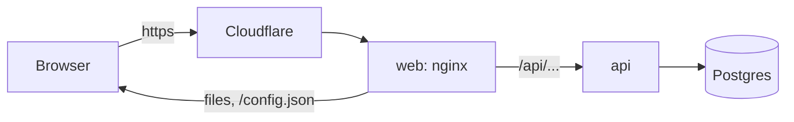

# Architecture

How the parts of the app fit together.

## 1. Images and apps

The repository builds three images, listed in `platform.yaml`. Each Environment runs them as two apps of one stamp, a Container Apps environment in Azure:

| Image | Built from | Runs as | What it does |
| --- | --- | --- | --- |
| `web` | `web/Dockerfile`, context `web/` | The app `web`, with a public hostname | nginx serving the React build on port 8080, and passing `/api` to the API |
| `api` | `src/Api/Dockerfile` | The app `api`, with internal ingress and no hostname | The .NET API on port 8080 |
| `migrator` | `src/Migrator/Dockerfile` | The init container of `api` | Migrates the database, then exits |

Every image runs as a non-root user. Both apps listen on port 8080 and answer `/healthz` and `/readyz`, which the platform probes.

## 2. Where data lives

The data is in Postgres, which comes from the stamp, not from this repository. In a dev stamp it is a container next to the apps, `ca-<stamp>-postgres`, which keeps its data only while it runs: after a restart, the migrator and the seed data build it again. Where the stamp chooses a managed service, such as Neon, the data stays. Either way the app gets the same setting, `DATABASE_URL` ([configuration.md](configuration.md)).

The API reads and writes through EF Core (`src/Api/Data/AppDbContext.cs`). The schema is the EF Core migrations in `src/Api/Data/Migrations/`.

## 3. Migrations

`migrator` runs before `api`, in every replica of every new revision:

1. It takes a Postgres advisory lock, so only one replica migrates at a time.
2. It applies the migrations that are missing, then the seed data (`src/Api/Data/SeedData.cs`), which adds sample items only to an empty table.
3. It exits. Then `api` starts.

The other replicas wait for the lock, find nothing left to do and exit. When the migrator fails, the new revision never becomes ready, and the previous revision keeps serving. So a revision never serves on a database it doesn't know.

The previous revision runs on the migrated database until the new one is ready, so every migration must be backward compatible ([deployment.md](deployment.md)).

## 4. A request, from the browser to the database

- The browser talks only to `web`, on the app's hostname, through Cloudflare. In a sandbox, Cloudflare Access asks for a sign-in first.
- nginx answers the files of the React build. A path that isn't a file gets `index.html`, and the router in the browser shows the page.
- nginx passes every request under `/api` to `api`, at `http://ca-<stamp>-api` inside the stamp, with the path unchanged. The page and the API share one origin, so the API needs no CORS settings.
- `api` answers from Postgres.

The template has no sign-in of its own. A product adds the sign-in it needs before its first production stamp, because production hostnames are public.

## 5. The front end

`web/src/main.tsx` loads `/config.json` first, then renders the app. `App.tsx` holds the routes and the layout; each feature is a folder in `web/src/features/`, and calls the API at the relative path `/api`. The build writes `web/dist/`, which the image serves; hashed files under `/assets/` are cached for a year.
